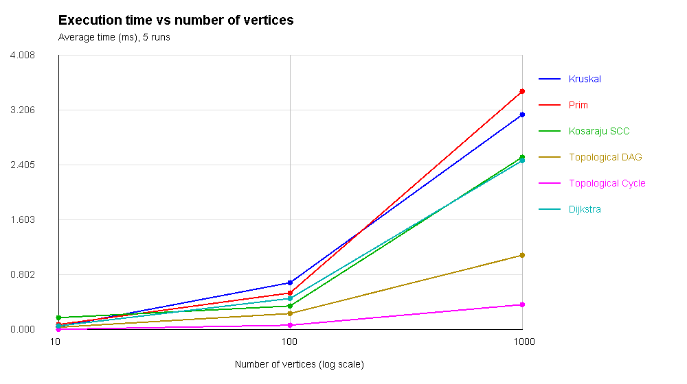
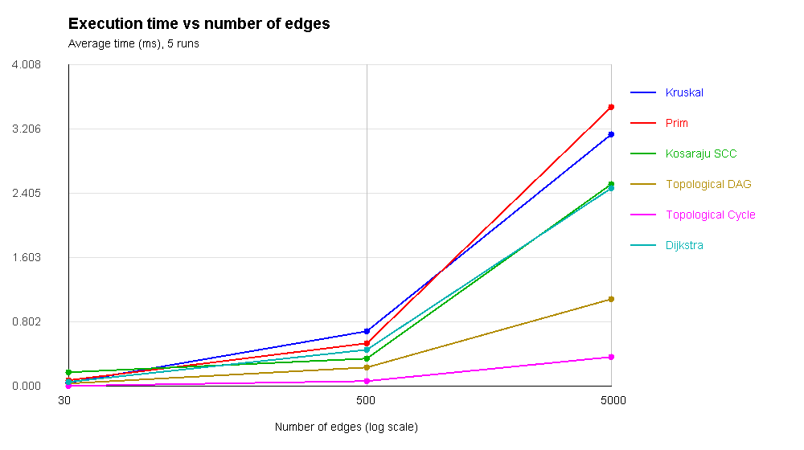

# Assignment 3 — Smart City Infrastructure and Route Planning

## Overview

This is a small Java console application about city districts and roads. A city is represented as a graph:

- A vertex is a district or location.
- An edge is a road or a connection between locations.
- A weight is the cost of a road or the distance to travel.

The program can find a low-cost road network, check directed connections, and find short routes. It uses standard Java classes, arrays, `ArrayList`, DFS, and `PriorityQueue`. The Java files are arranged by topic under `src`. The project uses no external frameworks.

## Implementation

| File | What it does |
|---|---|
| `graph/Graph.java`, `graph/Edge.java` | Store vertices, roads, weights, and adjacency lists. |
| `dsu/DSU.java` | `find` and `union`, with path compression and union by rank. |
| `mst/MST.java` | Kruskal and Prim, total cost, connected status, and operation counts. |
| `connectivity/Connectivity.java` | Topological sorting with Kahn's algorithm and SCC with Kosaraju's algorithm. |
| `shortestpath/Dijkstra.java` | Shortest distance from a chosen source to every vertex and the actual route. |
| `graph/GraphGenerator.java` | Makes random graphs using fixed seeds. |
| `tests/GraphTests.java` | Runs correctness checks without external testing libraries. |
| `benchmark/Benchmark.java` | Measures execution time and counts operations. Saves the results in CSV and Markdown. |
| `benchmark/Plots.java` | Creates the two execution-time graphs using standard Java graphics. |
| `app/Main.java` | Prints a small example, runs tests, and starts the benchmark. |

**Graph storage.** The implementation uses an adjacency list (`ArrayList<ArrayList<Edge>>`) and a separate list of edges. In an undirected graph, one road is stored once in the edge list and twice in the adjacency lists (one direction each). In a directed graph, every edge goes only one way.

**Kruskal.** Sort all roads by weight. Add a road if its endpoints are in different DSU groups. This avoids cycles. Return the selected roads, their total weight, and whether all districts are connected.

**Prim.** Start from a district and put candidate roads in a priority queue. Each time, choose the cheapest road that goes to an unvisited district. Store every selected road. If the graph has disconnected parts, the code also processes them; in that case it reports `connected = false`, because a single MST does not exist.

**Topological sort.** Count in-degrees. First take vertices with zero in-degree and then remove their outgoing edges. If not all vertices can be processed, a directed cycle exists and a topological order is impossible.

**Kosaraju SCC.** Run DFS to save finishing order, reverse all directed edges, then run DFS again in reverse finishing order. Each group found by the second DFS is one strongly connected component.

**Dijkstra.** Start with distance 0 for the source and infinity for other districts. Use a priority queue to process the nearest district and relax its outgoing edges. A `parent` array restores the full route. Unreachable districts keep an infinite distance and have an empty route. Negative edge weights are rejected: with negative weights, the greedy choice in Dijkstra may stop being correct.

## Complexity Analysis

Here, **V** is the number of vertices, **E** is the number of edges, and **α(V)** is the inverse Ackermann function (it grows very slowly). The algorithms use adjacency lists and a binary-heap `PriorityQueue`.

| Algorithm | Time complexity | Extra space | Explanation |
|---|---|---|---|
| DSU `find` / `union` | O(α(V)) amortized | O(V) for DSU arrays | Path compression shortens paths; union by rank prevents deep trees. |
| Kruskal | O(E log E + E α(V)) = O(E log E) | O(V + E) | Sorting edges is the main cost. DSU checks whether adding a road makes a cycle. |
| Prim | O(E log V) | O(V + E) | The priority queue contains possible roads; adjacency lists give nearby roads. |
| Kosaraju SCC | O(V + E) | O(V + E) | Two DFS passes and a reversed graph. |
| Topological sort (Kahn) | O(V + E) | O(V) | Every vertex is added to the queue at most once; edges are processed in two passes. |
| Dijkstra | O((V + E) log V) | O(V + E) | A binary heap chooses the next closest vertex; lazy duplicate entries are allowed in the queue. |

The full graph itself also takes O(V + E) memory. The extra space for algorithms is listed separately.

As V and E grow, sorting and priority-queue work affect Kruskal, Prim, and Dijkstra. DFS and topological sorting grow mainly with the number of vertices and edges. For the simple undirected graphs used here, E is at most V(V − 1) / 2 and log E is O(log V).

## Experimental Setup

The experiments use three graph sizes:

| Size | Vertices (V) | Edges (E) |
|---|---:|---:|
| Small | 10 | 30 |
| Medium | 100 | 500 |
| Large | 1000 | 5000 |

`java.util.Random` uses **fixed seeds** for repeatable graphs:

- **Undirected road graph, seed 42:** Each new vertex is first connected to a previous vertex. This gives a connected graph. Then more random roads are added until the required E is reached. Weights are integers from 1 to 100. Duplicate roads and self-loops are skipped.
- **Directed DAG, seed 43:** Random directed edges always go from a smaller vertex number to a larger number. This makes cycles impossible. Edges have weight 1.
- **Directed graph with a cycle, seed 44:** First add `0 → 1`, `1 → 2`, `2 → 0`. Then add other random directed edges. There is always at least one cycle. Edges have weight 1.

For each graph size, the benchmark measures **Kruskal, Prim, Kosaraju SCC, Topological DAG, Topological Cycle, and Dijkstra**. MST and Dijkstra use the undirected road graph, SCC and cycle detection use the directed cyclic graph, and DAG sorting uses the DAG graph. Dijkstra starts from district `0`.

**Measuring time:** The program creates the graphs before timing, does one warm-up run, then repeats every experiment **5 times**. It uses `System.nanoTime()` and reports the average in milliseconds. Graph generation and correctness checks are **outside** the measured time. Execution times may differ on another computer or JVM.

**Counting operations:** `Edge checks` means different useful steps for each algorithm: processed candidate roads (MST), scanned adjacency edges (DFS/Dijkstra), or inspected edges during in-degree processing (topological sort). `Other ops` means DSU `find + union` calls (Kruskal), priority-queue add/remove operations (Prim and Dijkstra), visited vertices across the two DFS passes (Kosaraju), or queue add/remove operations (topological sort). These are not all CPU instructions and should not be compared as identical units. Kruskal's sorting comparisons are included in its execution time, but not in the `Edge checks` column.

The sample measurements below were collected with OpenJDK 21 on Linux. Different computers may produce different execution times. The benchmark saves fresh CSV and Markdown tables, as well as two PNG plots, each time it runs.

The experiment can be repeated with Java 17 or newer using these commands:

```bash
javac -encoding UTF-8 -d out -sourcepath src src/app/Main.java
java -cp out benchmark.Benchmark
```

The tests can also be run with `java -cp out tests.GraphTests`.

## Results

### MST weights on connected road graphs

Both algorithms use the same road graph and give the same minimum cost.

| Graph | Kruskal cost | Prim cost | Connected |
|---|---:|---:|---|
| Small (10, 30) | 129 | 129 | Yes |
| Medium (100, 500) | 1170 | 1170 | Yes |
| Large (1000, 5000) | 13123 | 13123 | Yes |

### Average execution time and operations

| Size | V | E | Algorithm | Average time (ms) | Edge checks | Other ops | 
|---|---:|---:|---|---:|---:|---:|
| Small | 10 | 30 | Kruskal | 0.0328 | 14 | 59 |
| Small | 10 | 30 | Prim | 0.0505 | 30 | 60 |
| Small | 10 | 30 | Kosaraju SCC | 0.0484 | 90 | 20 |
| Small | 10 | 30 | Topological DAG | 0.0474 | 60 | 20 |
| Small | 10 | 30 | Topological Cycle | 0.0038 | 30 | 0 |
| Small | 10 | 30 | Dijkstra | 0.1418 | 60 | 36 |
| Medium | 100 | 500 | Kruskal | 0.5750 | 164 | 739 |
| Medium | 100 | 500 | Prim | 0.4478 | 500 | 1000 |
| Medium | 100 | 500 | Kosaraju SCC | 0.2632 | 1500 | 200 |
| Medium | 100 | 500 | Topological DAG | 0.1700 | 1000 | 200 |
| Medium | 100 | 500 | Topological Cycle | 0.0382 | 505 | 2 |
| Medium | 100 | 500 | Dijkstra | 0.3585 | 1000 | 400 |
| Large | 1000 | 5000 | Kruskal | 3.1483 | 3392 | 16507 |
| Large | 1000 | 5000 | Prim | 3.5813 | 5000 | 10000 |
| Large | 1000 | 5000 | Kosaraju SCC | 1.5431 | 15000 | 2000 |
| Large | 1000 | 5000 | Topological DAG | 0.9745 | 10000 | 2000 |
| Large | 1000 | 5000 | Topological Cycle | 0.2207 | 5027 | 8 |
| Large | 1000 | 5000 | Dijkstra | 1.9016 | 10000 | 3974 |

The full numeric results are also stored in [benchmark.csv](results/tables/benchmark.csv).

### Plot 1 — Execution time vs. number of vertices



### Plot 2 — Execution time vs. number of edges



Both figures use a logarithmic x-axis so that all three graph sizes can be seen clearly. The graph sizes increase in both V and E, so the charts show overall growth; they do not isolate the effect of only one variable.

## Comparison and Discussion

**Kruskal vs Prim.** Both found exactly the same MST total weight on the connected road graphs. They can choose different roads when equal weights exist, but the minimum total is the same. Kruskal sorts edges and uses DSU. Prim uses a priority queue and grows from visited districts. The faster one may change between runs because the JVM and PC affect small timing values. For sparse graphs, both are reasonable solutions.

**Why DSU helps.** Without path compression, finding the group leader could follow a long chain. Path compression makes later calls shorter. Union by rank usually keeps smaller trees under larger trees. Together, they make repeated `find` and `union` operations very fast.

**SCC.** The experiment shows more work when going from 10 vertices / 30 edges to 1000 vertices / 5000 edges. Kosaraju scans the vertices and edges only a small number of times. This agrees with O(V + E).

**Topological ordering.** All tested DAGs received a valid ordering. Graphs containing a cycle were rejected. The cycle test can look unusually fast: with an early cycle, the queue may contain very few or no zero-in-degree vertices, so the algorithm finishes after building in-degrees. This does not mean cyclic graphs are always easier.

**Dijkstra.** Its runtime and number of edge checks increase with graph size. For an undirected connected graph, every road appears twice in the adjacency lists, so the algorithm usually examines about 2E directed adjacency entries. Distances were correct in the tests. The algorithm only works safely with non-negative weights.

**Theory vs practice.** The large graphs generally need more time and operations, which matches the complexity analysis. However, the timing numbers are small, and Java warm-up, memory use, and background processes can change them. Operation counts are more stable because the same graphs and seeds are used.

## Testing

`GraphTests.java` runs **51 checks**. These include:

- A small connected graph with a known MST cost.
- A disconnected graph (both MST methods say `connected = false`).
- A directed graph that contains cycles (topological sort rejects it).
- A graph with several valid MSTs and equal edge weights.
- An unreachable district in Dijkstra (infinite distance and empty path).
- A graph with one vertex (zero MST cost and shortest distance zero).
- DSU `find`, `union`, and repeated union operations.
- A valid topological order: every edge goes from an earlier to a later vertex.
- SCC correctness: every vertex belongs to exactly one component.
- Dijkstra shortest distances and the full reconstructed path.
- Rejection of negative weights by Dijkstra.
- Reproducibility with the same graph generator seed.
- Comparison of Kruskal and Prim weights on connected graphs.

Result of the included tests:

```text
All 51 tests passed!
```

For the benchmarks, the program also checks correct MST weights, cycle detection, SCC vertex totals, and Dijkstra reachability after each run.

## Conclusion

The application shows different useful graph algorithms for a simple smart city. Kruskal and Prim can connect districts at a minimum cost. Topological sorting helps when roads or tasks have an order without cycles. Kosaraju finds groups of districts that can reach each other by one-way roads. Dijkstra finds the shortest routes from one starting district. Choosing the algorithm depends on the type of graph and the problem being solved.
